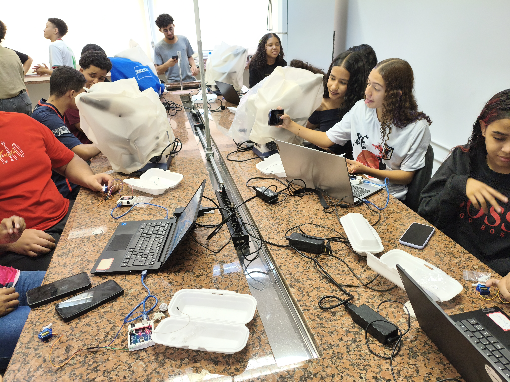
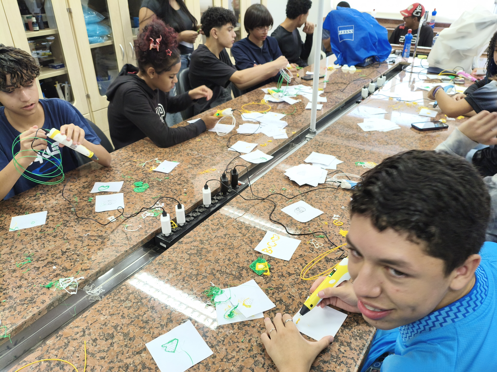

# Fotografias

Registros da atividade apresentada na [pasta do projeto, curso ou evento](../README.md).

## Arquivos

- [curso_arduino_para_PartiuIF.jpg](<curso_arduino_para_PartiuIF.jpg>)
- [workshop_caneta3D_partiuIF.jpg](<workshop_caneta3D_partiuIF.jpg>)
