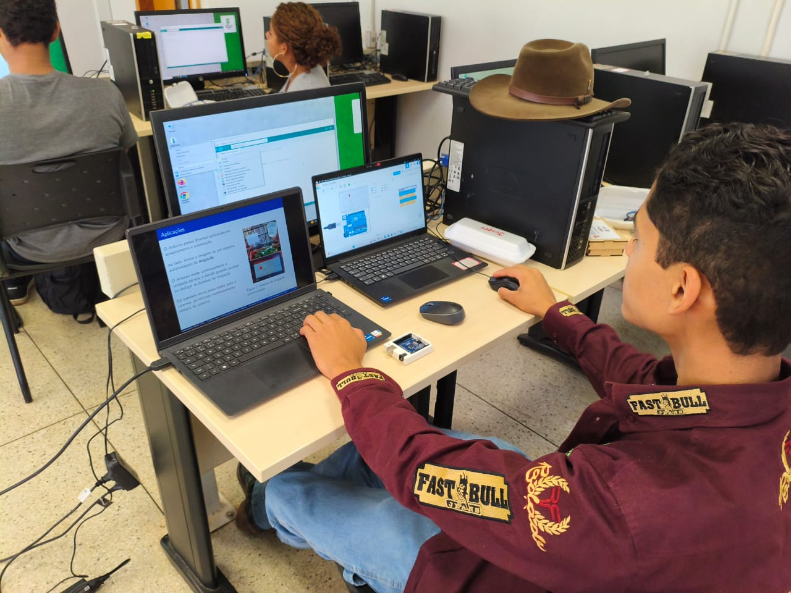
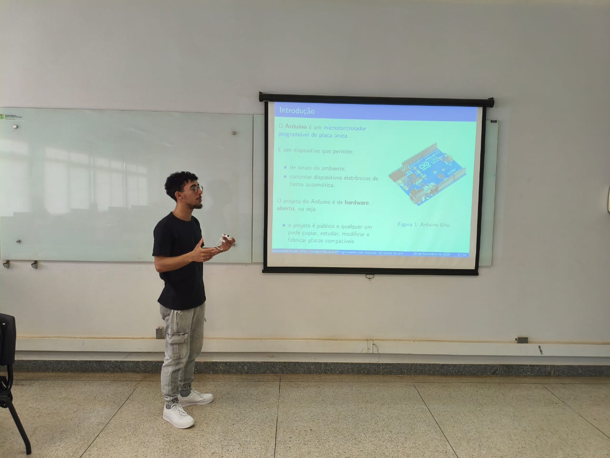
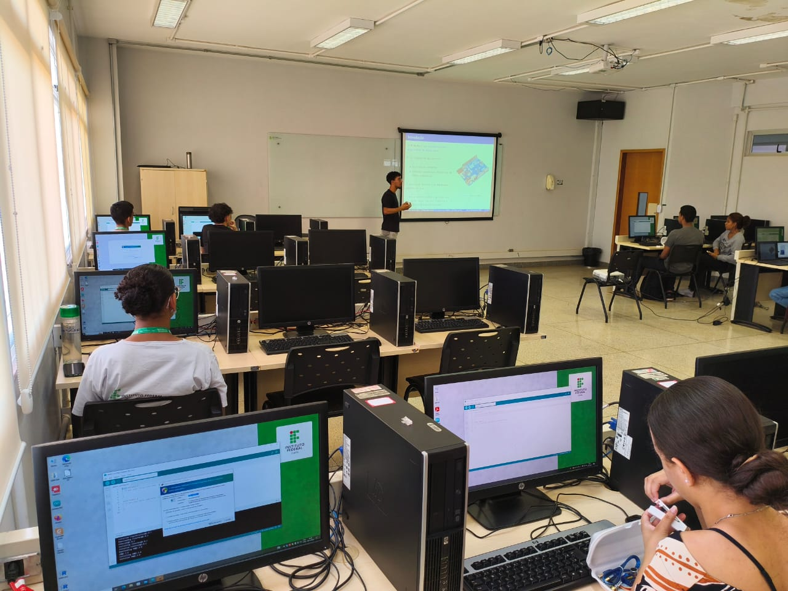
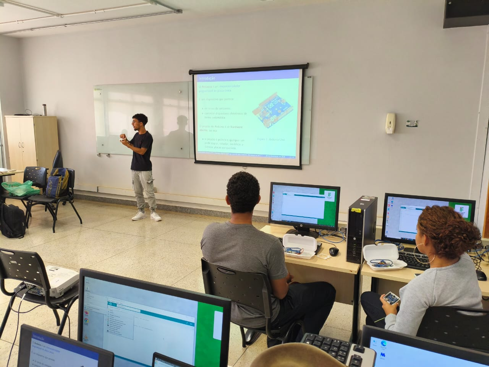

# Fotografias

Registros da atividade apresentada na [pasta do projeto, curso ou evento](../README.md).

## Arquivos

- [curso_arduino1.jpeg](<curso_arduino1.jpeg>)
- [curso_arduino2.jpeg](<curso_arduino2.jpeg>)
- [curso_arduino3.jpeg](<curso_arduino3.jpeg>)
- [curso_arduino4.jpeg](<curso_arduino4.jpeg>)
