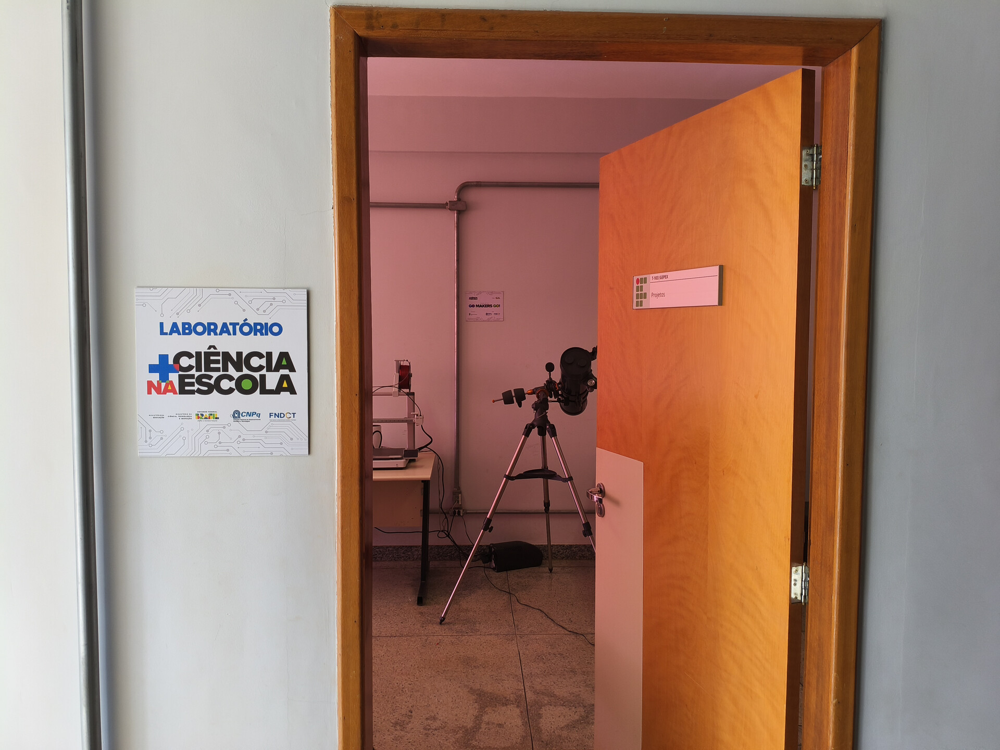
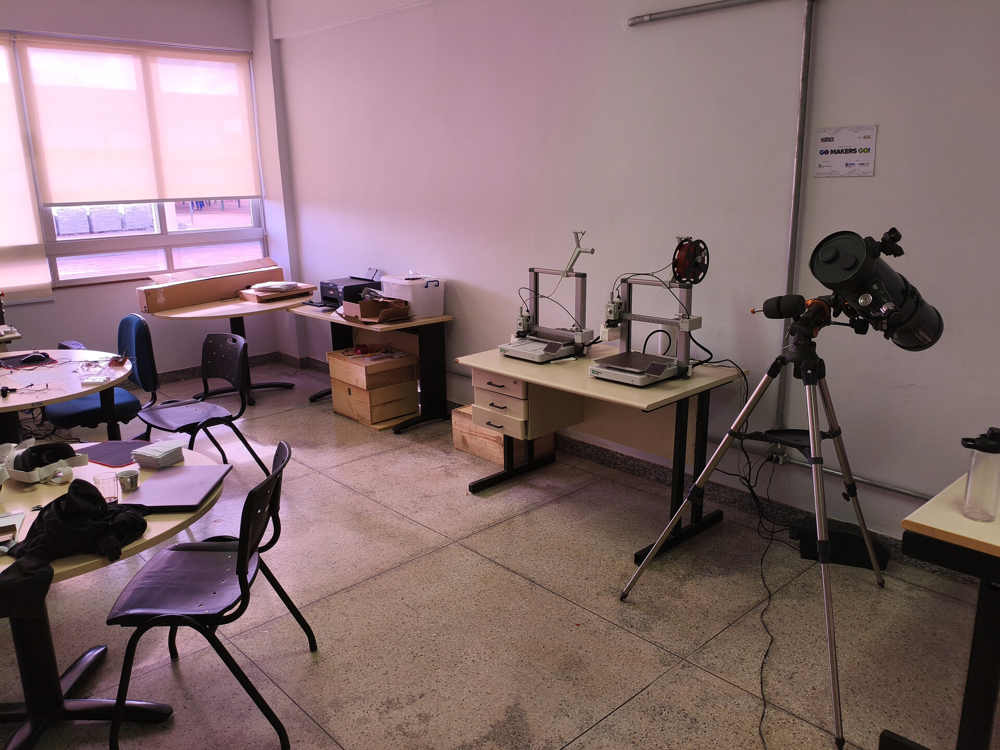

# Fotografias

Registros da atividade apresentada na [pasta do projeto, curso ou evento](../README.md).

## Arquivos

- [1000119717.heic](<1000119717.heic>)
- [entrada-laboratorio.jpg](<entrada-laboratorio.jpg>)
- [laboratorio-interno.jpg](<laboratorio-interno.jpg>)

Os arquivos HEIC preservam o formato original da câmera. Baixe-os para abrir em um aplicativo compatível.
