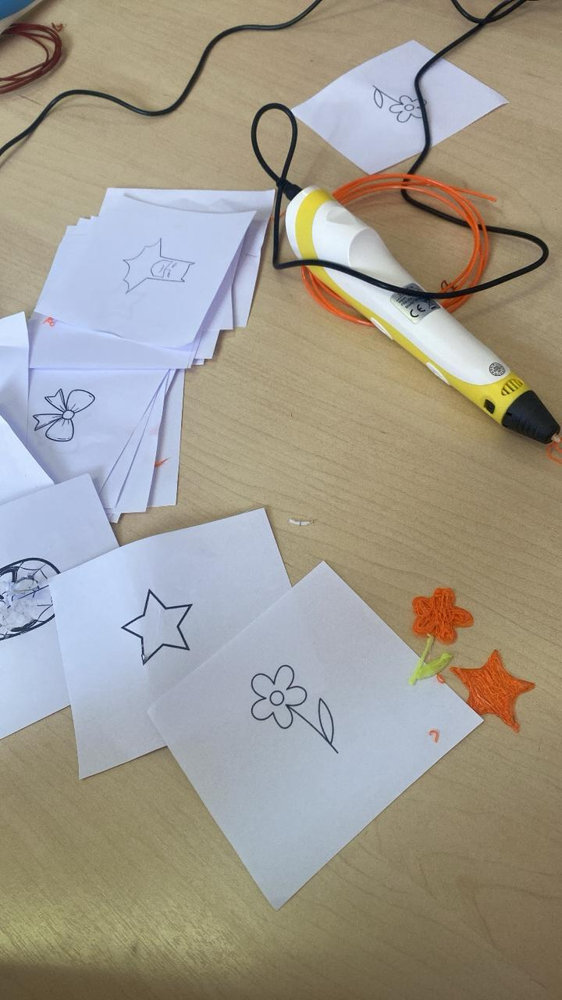
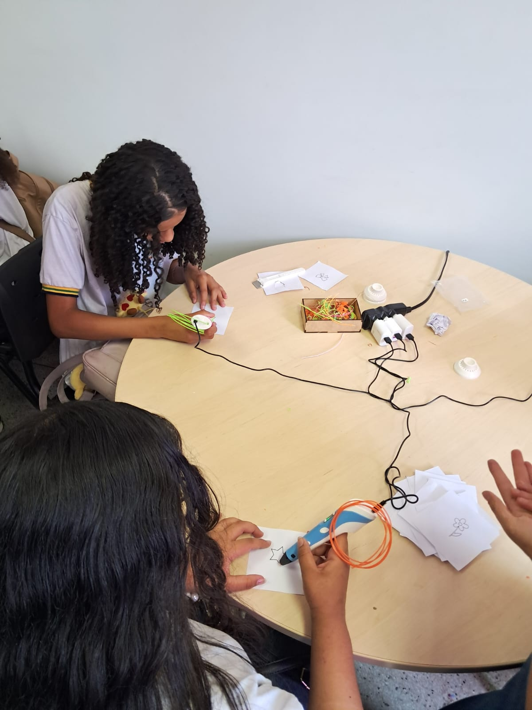
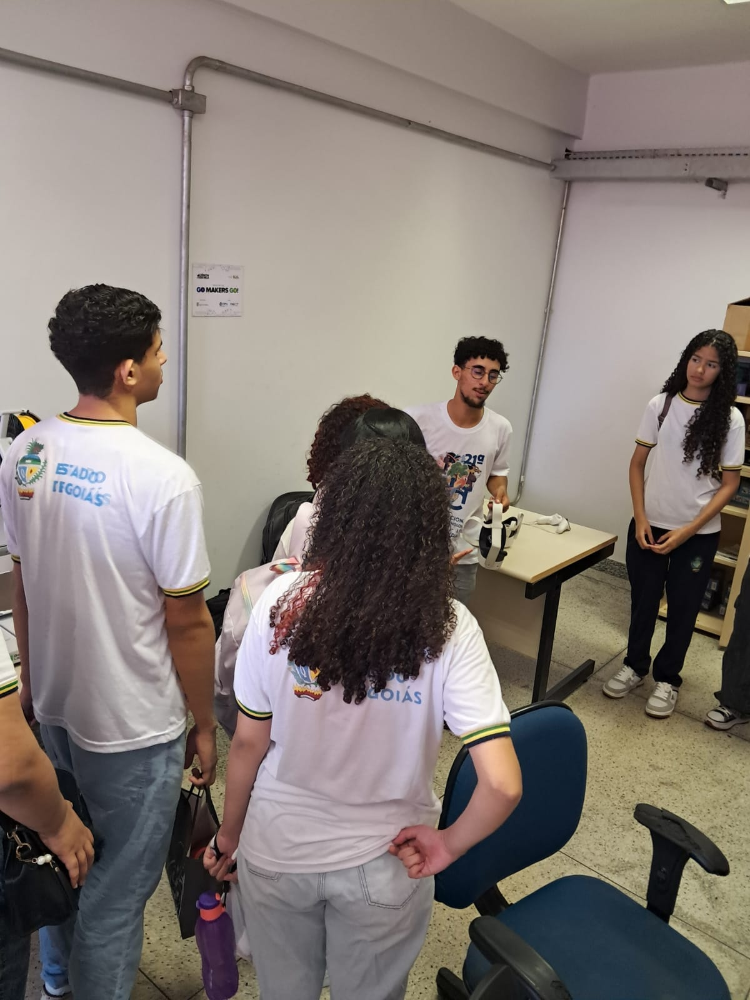
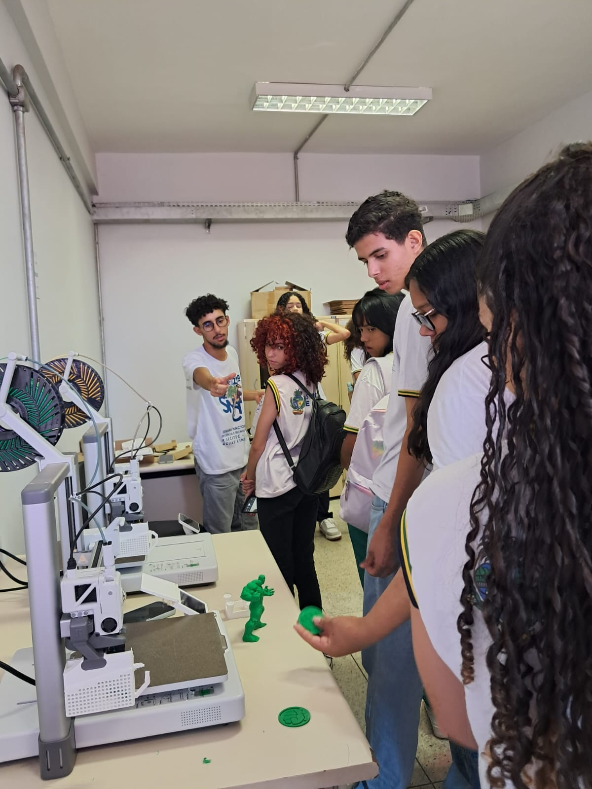
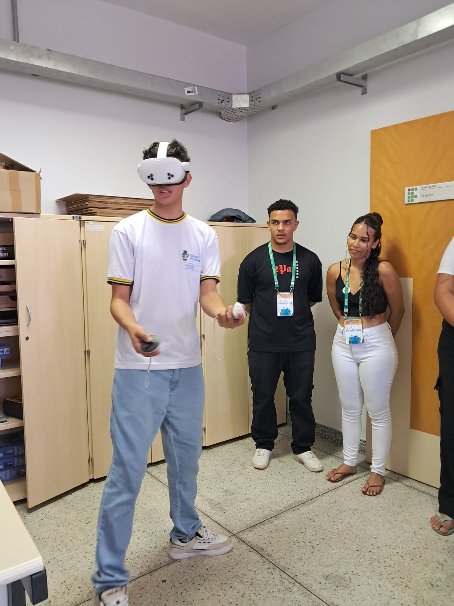

# Fotografias

Registros da atividade apresentada na [pasta do projeto, curso ou evento](../README.md).

## Arquivos

- [workshop_caneta3d_oculosVR1.jpeg](<workshop_caneta3d_oculosVR1.jpeg>)
- [workshop_caneta3d_oculosVR2.jpeg](<workshop_caneta3d_oculosVR2.jpeg>)
- [workshop_caneta3d_oculosVR3.jpeg](<workshop_caneta3d_oculosVR3.jpeg>)
- [workshop_caneta3d_oculosVR4.jpeg](<workshop_caneta3d_oculosVR4.jpeg>)
- [workshop_caneta3d_oculosVR5.jpeg](<workshop_caneta3d_oculosVR5.jpeg>)
