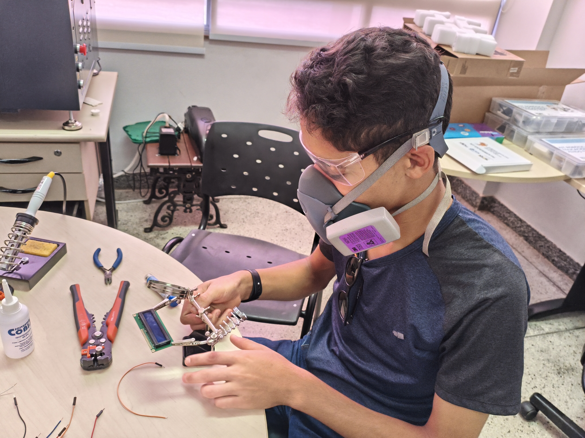
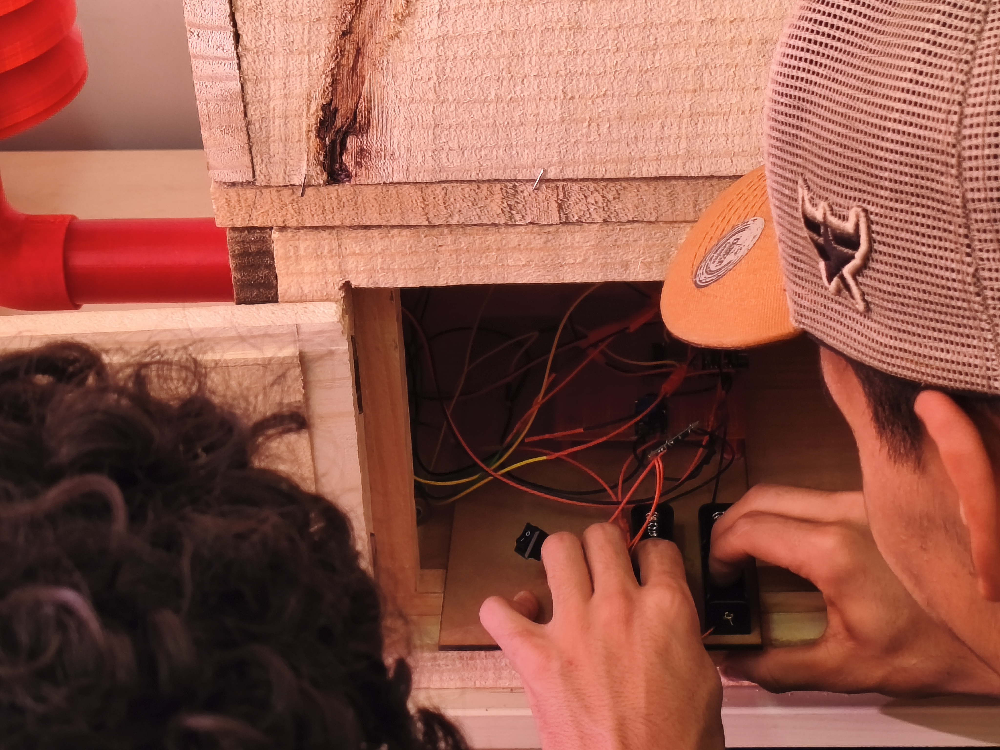
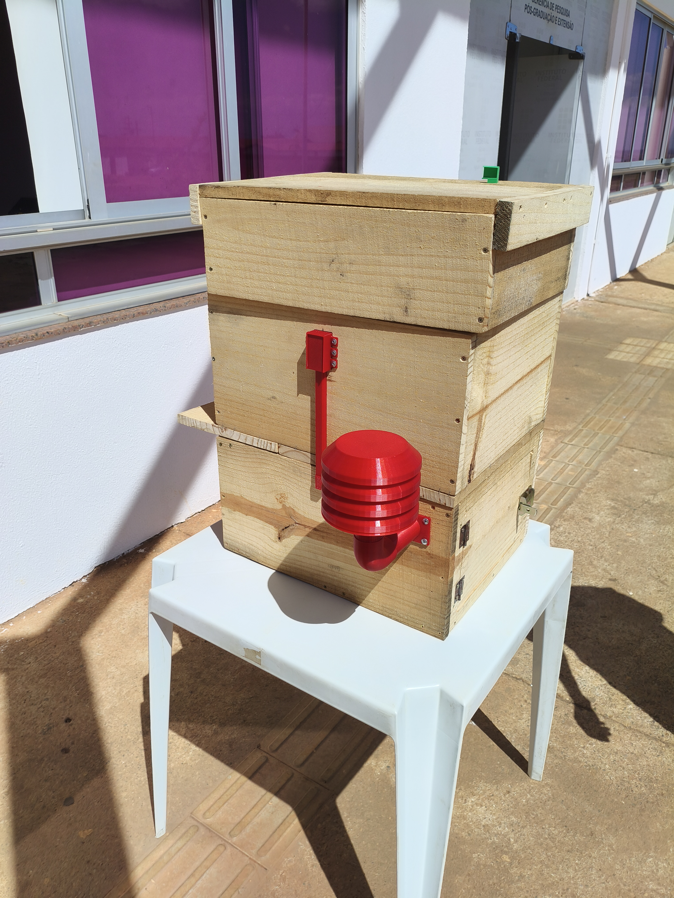
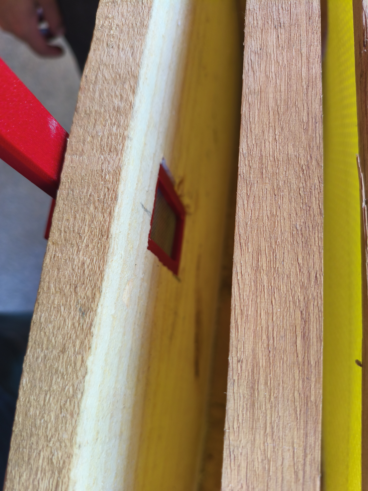
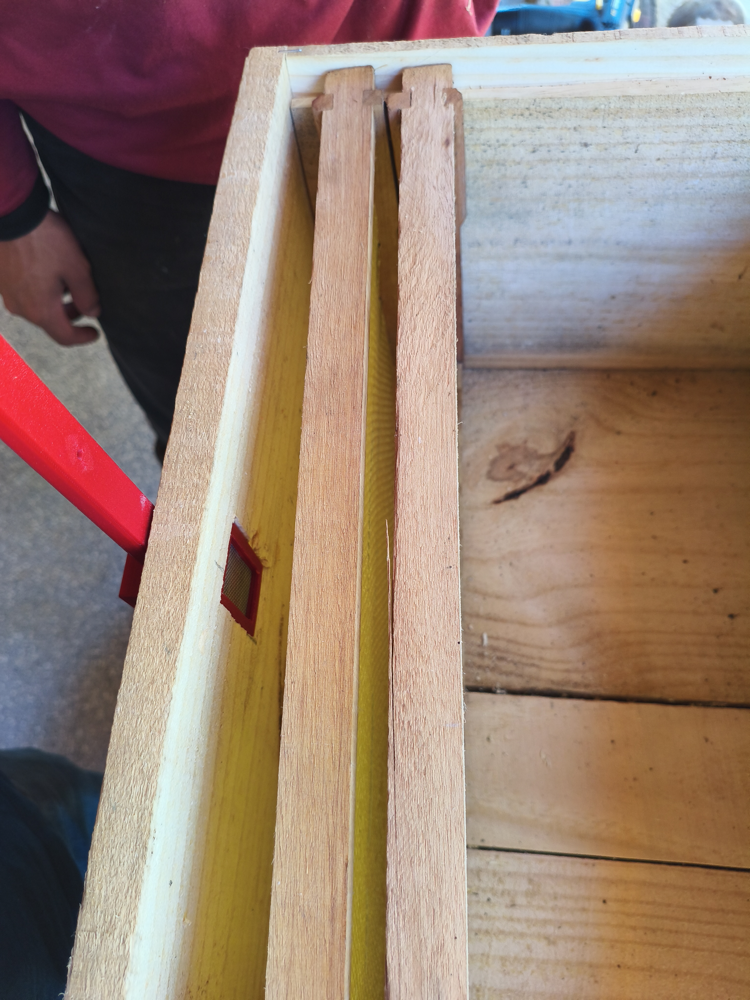
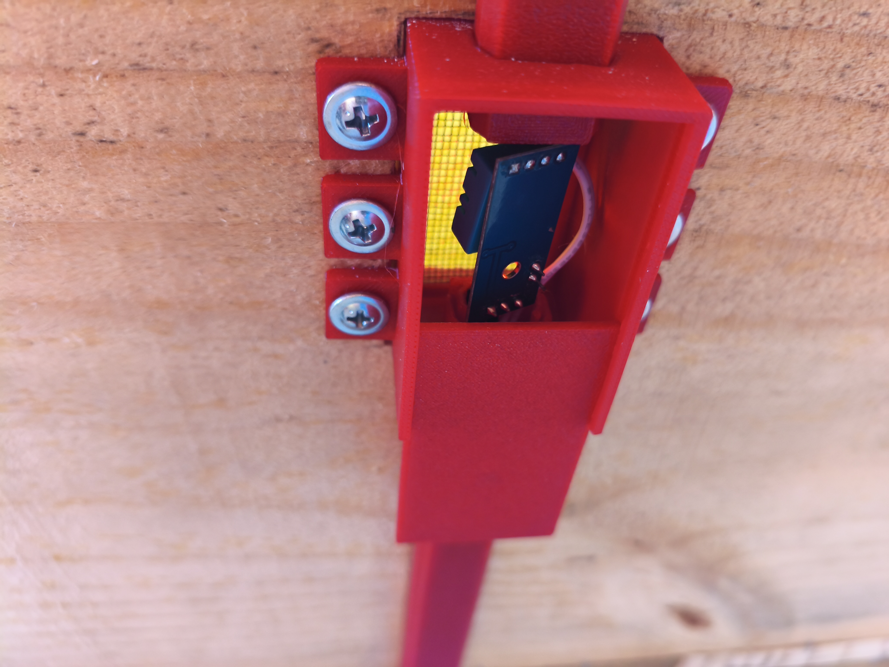

# Fotografias

Registros da atividade apresentada na [pasta do projeto, curso ou evento](../README.md).

## Arquivos

- [1000083798.jpg](<1000083798.jpg>)
- [1000102346.jpg](<1000102346.jpg>)
- [1000108904.jpg](<1000108904.jpg>)
- [1000113574.jpg](<1000113574.jpg>)
- [1000113575.jpg](<1000113575.jpg>)
- [1000113576.jpg](<1000113576.jpg>)
- [1000113578.jpg](<1000113578.jpg>)
- [1000113579.jpg](<1000113579.jpg>)
- [1000113624.heic](<1000113624.heic>)
- [1000120746.jpg](<1000120746.jpg>)
- [1000120747.jpg](<1000120747.jpg>)
- [IMG-20260702-WA0058.jpg]()
- [circuito_colmeia.jpg](<circuito_colmeia.jpg>)
- [colmeia.jpg](<colmeia.jpg>)
- [colmeia.png](<colmeia.png>)

Os arquivos HEIC preservam o formato original da câmera. Baixe-os para abrir em um aplicativo compatível.
