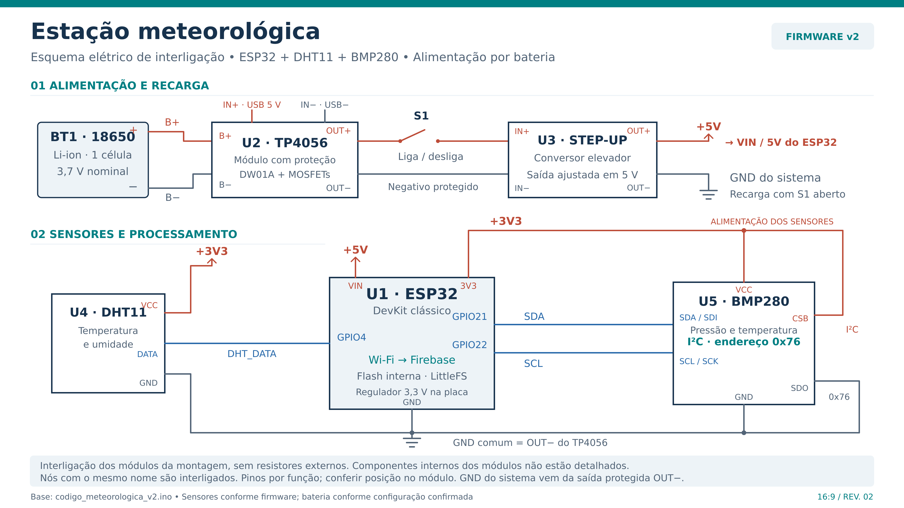
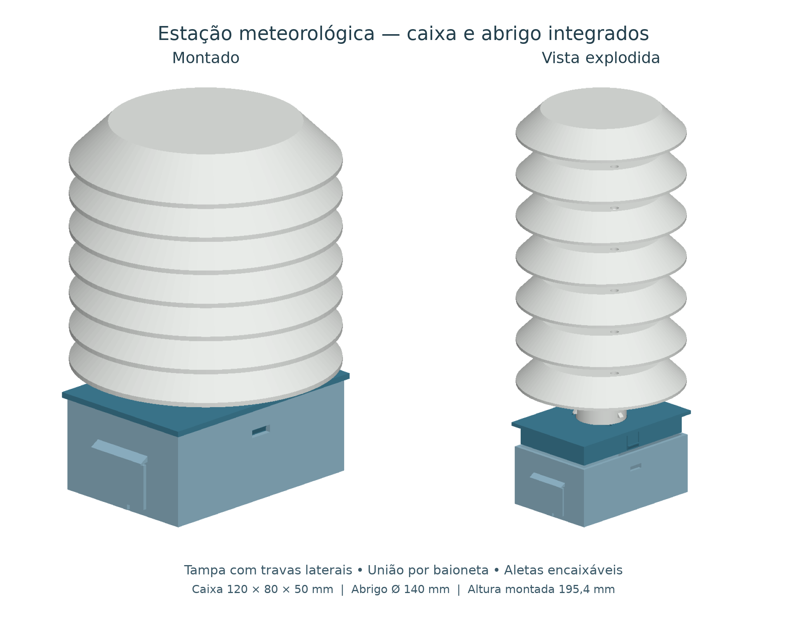

# Estação meteorológica

**Situação em outubro de 2026:** concluído, com protótipo montado e aquisição e transmissão testadas.

Construímos uma estação com ESP32, DHT11 e BMP280 para acompanhar temperatura, umidade relativa e pressão atmosférica. Fabricamos a estrutura por impressão 3D e transmitimos dados por Wi-Fi ao Firebase.

**Atualização de novembro de 2026:** esquema elétrico por módulos, modelos integrados com e sem circuito e guia de montagem. A estrutura integrada é uma evolução para fabricação e ensaio: as verificações digitais de encaixe não equivalem à validação física desse novo conjunto.

## Circuito e montagem

- [Guia de montagem da estação integrada](guias/montagem-integrada.md): materiais, impressão, encaixes, ligações e conferência inicial.
- [Esquema do circuito e tabela de ligações](circuito/README.md), com arquivos [SVG](circuito/esquema_circuito_estacao_meteorologica.svg), [PNG](circuito/esquema_circuito_estacao_meteorologica.png) e [PDF](circuito/esquema_circuito_estacao_meteorologica.pdf).
- [Modelo integrado sem circuito](modelos-3d/estacao-integrada/estacao_integrada.scad): estrutura paramétrica, vistas montada e explodida, peças e amostras para impressão.
- [Modelo integrado com circuito](modelos-3d/estacao-integrada/estacao_integrada_com_circuito.scad): disposição ilustrativa dos componentes, fios e sensores. Baixe também o arquivo sem circuito e mantenha ambos na mesma pasta.
- [STL das peças e testes](modelos-3d/estacao-integrada/STL/) e [manual ilustrado de encaixes](modelos-3d/estacao-integrada/manual_testes_encaixes.pdf).

A prévia acima documenta a estrutura R2; o teto atual também possui uma [alça interna para sensores](modelos-3d/estacao-integrada/previa_teto_com_alca.png). Consulte as [instruções dos modelos](modelos-3d/estacao-integrada/LEIA-ME.md) para as diferenças entre revisões.

## Outros materiais

- [Código](codigo/): preencha as configurações locais de rede e acesso antes de usar o firmware. O esquema documenta a montagem com DHT11 no GPIO4 e BMP280 I²C em 0x76; confira esses parâmetros na versão de firmware escolhida.
- [Modelos 3D](modelos-3d/), incluindo as peças anteriores.
- [Dados](dados/) e [fotos](fotos/).
- [Guias anteriores](guias/): o passo a passo e a lista de materiais antigos citam BME280. Para a montagem com DHT11 + BMP280, siga o novo guia acima.

[Voltar ao índice geral](../../../README.md)
