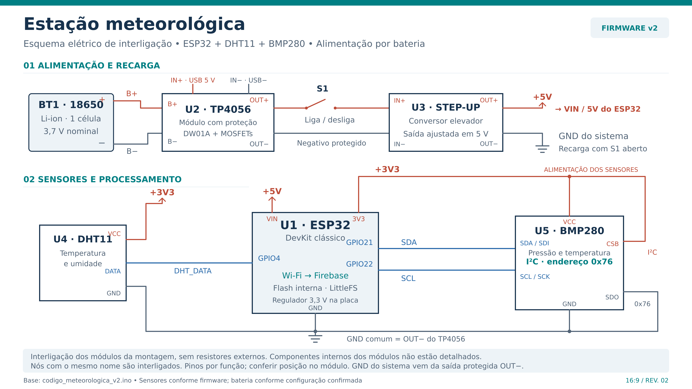

# Circuito da estação meteorológica

Esquema por módulos da montagem com ESP32 clássico, DHT11, BMP280, uma célula 18650, TP4056 com proteção, chave S1 e conversor elevador ajustado para 5 V. Corresponde ao esquema local revisado em 03/11/2026 e aos sensores do firmware v2.

Arquivos: [SVG editável](esquema_circuito_estacao_meteorologica.svg), [PNG](esquema_circuito_estacao_meteorologica.png) e [PDF](esquema_circuito_estacao_meteorologica.pdf).

## Ligações

| Origem | Destino |
| --- | --- |
| 18650 positivo / negativo | TP4056 B+ / B− |
| USB 5 V de recarga | Entrada USB do TP4056 (IN+ / IN−) |
| TP4056 OUT+ | S1 → IN+ do conversor elevador |
| TP4056 OUT− | IN− do conversor e GND do sistema |
| Conversor OUT+ ajustado para 5 V | ESP32 VIN / 5V |
| Conversor OUT− | GND do sistema |
| ESP32 3V3 | DHT11 VCC; BMP280 VCC e CSB |
| ESP32 GPIO4 | DHT11 DATA |
| ESP32 GPIO21 | BMP280 SDA / SDI |
| ESP32 GPIO22 | BMP280 SCL / SCK |
| GND do sistema | ESP32 GND; DHT11 GND; BMP280 GND e SDO |

CSB alto seleciona I²C no BMP280; SDO baixo seleciona o endereço 0x76. Em módulos de quatro terminais, essas seleções são internas: confira o endereço do módulo. GPIO21/22 correspondem ao I²C padrão do ESP32 clássico; outras famílias e placas exigem conferir a pinagem.

## Condições da montagem representada

- O TP4056 deve ser a versão com proteção e terminais B± e OUT±. Ligue a carga em OUT± e mantenha B− separado de OUT− externamente para preservar a proteção. Recarregue com S1 aberto; este arranjo não representa gerenciamento de alimentação simultânea durante a carga.
- Ajuste e meça a saída do conversor em 5 V antes de conectá-lo ao ESP32. Confira a entrada VIN/5V do DevKit e a capacidade do conversor para os picos de Wi-Fi. A bateria não alimenta diretamente o pino 3V3. Durante a programação USB, mantenha S1 aberto.
- O DHT11 adotado deve ser compatível com 3,3 V e cabo curto. DATA vai diretamente ao GPIO4, conforme a montagem informada. O terminal NC, quando presente, fica livre. A ordem dos terminais varia entre módulos.
- O BMP280 utiliza alimentação e sinais em 3,3 V. A umidade vem do DHT11; o BMP280 mede pressão e temperatura.
- O desenho registra a montagem informada sem resistores ou capacitores auxiliares externos. Componentes internos dos módulos não são detalhados. Confira as exigências do módulo adquirido para os sinais e para o barramento I²C.
- O esquema mostra funções elétricas; a posição dos pinos no desenho não é um gabarito dos conectores. O modelo 3D com circuito mostra disposição física aproximada, com adaptadores e terminais ilustrativos.

O deep sleep do ESP32 não desliga o conversor, os sensores ou os LEDs dos módulos.

## Referências técnicas

- [Espressif — I²C no Arduino-ESP32](https://docs.espressif.com/projects/arduino-esp32/en/latest/api/i2c.html).
- [Bosch Sensortec — datasheet BMP280](https://www.bosch-sensortec.com/media/boschsensortec/downloads/datasheets/bst-bmp280-ds001.pdf).
- [Adafruit — conexão de sensores DHT](https://learn.adafruit.com/dht/connecting-to-a-dhtxx-sensor).

Veja o [guia de montagem](../guias/montagem-integrada.md) e os [modelos integrados](../modelos-3d/estacao-integrada/LEIA-ME.md).
