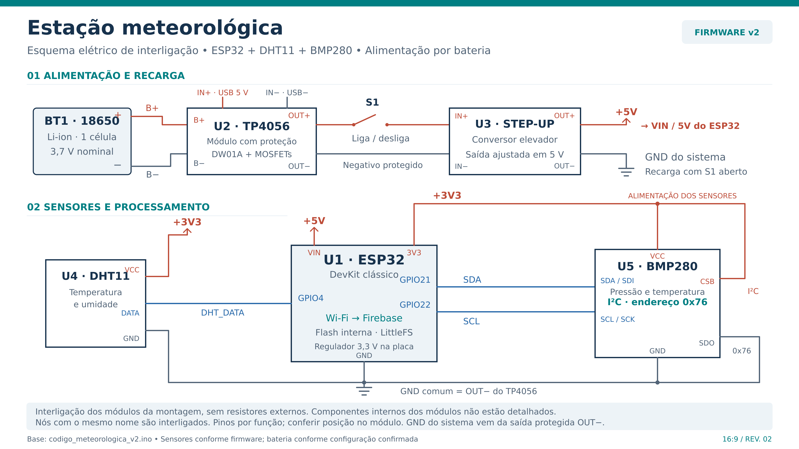
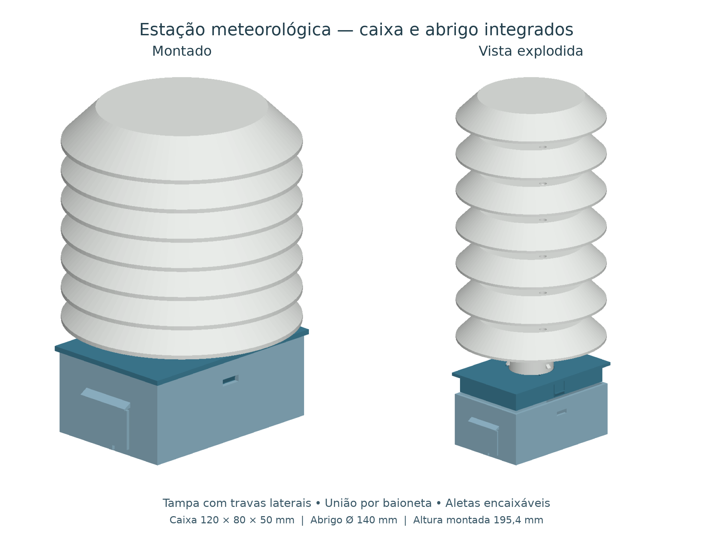

# Montagem da estação meteorológica integrada

Este guia reúne a estrutura por encaixes e o circuito com **ESP32, DHT11 e BMP280**, alimentado por uma célula 18650, TP4056 protegido e conversor elevador para 5 V. Os guias antigos com BME280 descrevem outra configuração.

## 1. Separe os materiais

| Material | Quantidade / observação |
| --- | --- |
| ESP32 DevKit clássico | 1; confira entrada VIN/5V e pinagem |
| DHT11 compatível com 3,3 V | 1; temperatura e umidade |
| BMP280 com lógica em 3,3 V | 1; I²C em 0x76 |
| Célula 18650 e suporte | 1 de cada, com polaridade identificada |
| TP4056 com proteção | 1, com B± e OUT± separados |
| Conversor elevador | 1, ajustado para 5 V e dimensionado para o ESP32/Wi-Fi |
| Chave liga/desliga S1 | 1, em série com a entrada positiva do conversor |
| Breadboard com réguas removíveis | 1, corpo central aproximado de 83 × 35 × 9 mm após remover ambas as réguas |
| Jumpers, isolantes e adaptadores | Conforme os conectores reais |
| Abraçadeiras e espaçadores | Para fixar os sensores sem cobrir suas aberturas |
| Peças impressas | Caixa, tampa, portinha, base do abrigo, cinco aletas e teto |

O modelo com circuito pressupõe ESP32 de aproximadamente 49 × 28 mm, TP4056 de 26 × 17 mm, conversor de 34 × 17 mm e suporte de bateria de 78 × 22 × 22 mm. Meça os componentes adquiridos. Uma breadboard inteira de 83 × 55 mm não cabe nessa disposição junto ao suporte; o corpo central usado tem 300 contatos após a retirada das réguas.

## 2. Consulte os modelos

Baixe a pasta [estacao-integrada](../modelos-3d/estacao-integrada/) com seus arquivos auxiliares.

- **Sem circuito:** abra `estacao_integrada.scad` no OpenSCAD e pressione F5. Use `visualizacao="montado"`, `"explodido"` ou `"corte"` para entender as peças. Este arquivo contém toda a geometria da estrutura.
- **Com circuito:** abra `estacao_integrada_com_circuito.scad`, mantendo o arquivo anterior na mesma pasta. Use `vista="corte"`, `"montado"`, `"eletronica"` ou `"caixa_aberta"`. Os controles `mostrar_fios` e `mostrar_rotulos` ajudam a inspecionar a disposição.

Os componentes eletrônicos e suas conexões gráficas são ilustrativos. Faça as ligações pela [tabela elétrica](../circuito/README.md), conferindo os terminais reais.

## 3. Imprima as peças

Os encaixes já foram conferidos na montagem física pelo responsável pelo projeto. Os arquivos de fabricação estão na pasta [STL](../modelos-3d/estacao-integrada/STL/). Imprima:

| Peça | Quantidade | Orientação fornecida no STL |
| --- | ---: | --- |
| `caixa.stl` | 1 | Fundo na mesa |
| `tampa_caixa.stl` | 1 | Face externa na mesa, saia e soquete para cima |
| `portinha.stl` | 1 | Face externa na mesa |
| `base_abrigo.stl` | 1 | Face plana central na mesa, tubo para cima |
| `aleta.stl` | 5 | Face plana na mesa, pinos para cima |
| `teto.stl` | 1 | Face externa na mesa, pinos e alça para cima |

Confira no fatiador as pontes, as linguetas, os canais da baioneta e a alça do teto. Remova rebarbas das interfaces. Alterações nas folgas exigem reexportar as peças afetadas; consulte o [LEIA-ME técnico](../modelos-3d/estacao-integrada/LEIA-ME.md).

Imprima as peças individualmente. A vista montada e o conjunto com circuito não são arquivos para imprimir em bloco.

## 4. Prepare a alimentação e os sensores

1. Com S1 aberto e a alimentação desconectada, confira os terminais dos módulos e a polaridade do suporte. Ligue o suporte em B+ e B− do TP4056 protegido.
2. Ligue OUT+ do TP4056 à chave S1 e dela a IN+ do conversor. OUT− do TP4056 vai a IN− do conversor. Não faça uma ponte externa entre B− e OUT−.
3. Com o ESP32 desconectado da saída, alimente o conversor e ajuste a saída para **5 V**, medidos com multímetro. Abra S1 antes das próximas conexões.
4. Ligue OUT+ do conversor à entrada VIN/5V compatível do ESP32 e OUT− ao GND. Distribua o GND comum aos sensores.
5. Ligue DHT11 VCC a 3V3, GND ao terra e DATA ao GPIO4. Deixe NC livre, se existir.
6. Ligue BMP280 VCC a 3V3, GND ao terra, SDA/SDI ao GPIO21 e SCL/SCK ao GPIO22. Quando expostos, ligue CSB a 3V3 e SDO a GND para I²C em 0x76.

As linhas vermelhas na vista 3D incluem tensões diferentes ao longo do circuito: bateria, 5 V e 3,3 V. A cor não significa que pertençam ao mesmo nó elétrico.

## 5. Monte a estrutura

1. **Organize o chicote:** passe os fios dos sensores pela abertura central de 20 mm da base e pelo tubo, deixando folga para abrir a caixa e para o giro da baioneta.
2. **Fixe os sensores:** a disposição ilustrada usa espaçadores de 4 mm e abraçadeiras nos rasgos da base. Mantenha as aberturas expostas ao ar. Como alternativa, o teto atualizado possui alça interna para suspender os sensores; nesse caso, ajuste o chicote e confira o espaço durante o fechamento. A vista 3D com circuito ainda ilustra os sensores na base.
3. **Una o abrigo à tampa:** com a tampa fora da caixa, alinhe os três pinos do tubo às entradas do soquete. Insira, gire 30° no sentido dos canais e deixe o abrigo descer 1,2 mm até o assento. O colar apoia no topo da tampa.
4. **Acomode a eletrônica:** fixe o suporte de bateria ao fundo com adesivo adequado, mantendo a célula removível. Posicione a breadboard e os módulos com isolamento. Os adaptadores do desenho são ilustrativos e precisam corresponder às placas reais. Preserve a região central superior ocupada pelo soquete e os 16 mm da saia junto às paredes.
5. **Confira as ligações e feche a caixa:** alinhe a saia e pressione perto das duas linguetas até os ganchos engatarem nas janelas. Evite prender fios entre as peças. A chave fica dentro da caixa; esta versão não acrescenta furos para chave ou USB.
6. **Empilhe as cinco aletas:** pressione junto às três torres de cada nível até os apoios encostarem. Encaixe o teto por último, conferindo a alça e os fios. Pressione a portinha na abertura lateral.

O conjunto mede aproximadamente 140 × 140 × 195,4 mm. A imagem R2 precede a inclusão da alça; veja a [prévia do teto atualizado](../modelos-3d/estacao-integrada/previa_teto_com_alca.png).

## 6. Confira o funcionamento

Com a caixa aberta, confirme a ausência de curtos e as tensões de 5 V e 3,3 V nos pontos previstos. Durante a gravação por USB, mantenha S1 aberto. Configure rede e acesso aos dados na versão de firmware escolhida, confira DHT11/GPIO4 e BMP280/0x76 e acompanhe a inicialização e as leituras no monitor serial. Acompanhe também o envio por Wi-Fi e o funcionamento pela bateria antes do fechamento definitivo.

Para recarregar, abra S1 e utilize a entrada USB do TP4056. O arranjo não inclui gerenciamento de alimentação simultânea durante a carga. A chave interna exige abrir a caixa para acesso.

## 7. Abra para manutenção

Comprima os dois ganchos pelas janelas e levante a tampa. Para separar o abrigo, segure a tampa, levante o abrigo cerca de 1,2 mm, gire de volta e retire. Para desmontar a pilha, comece pelo teto e comprima os pinos pelas janelas; não use as saias como alavanca. Acompanhe o chicote para evitar tração nos sensores.

Os encaixes já foram conferidos na montagem física. A estrutura não possui grau IP estabelecido.

[Voltar à estação meteorológica](../README.md)
