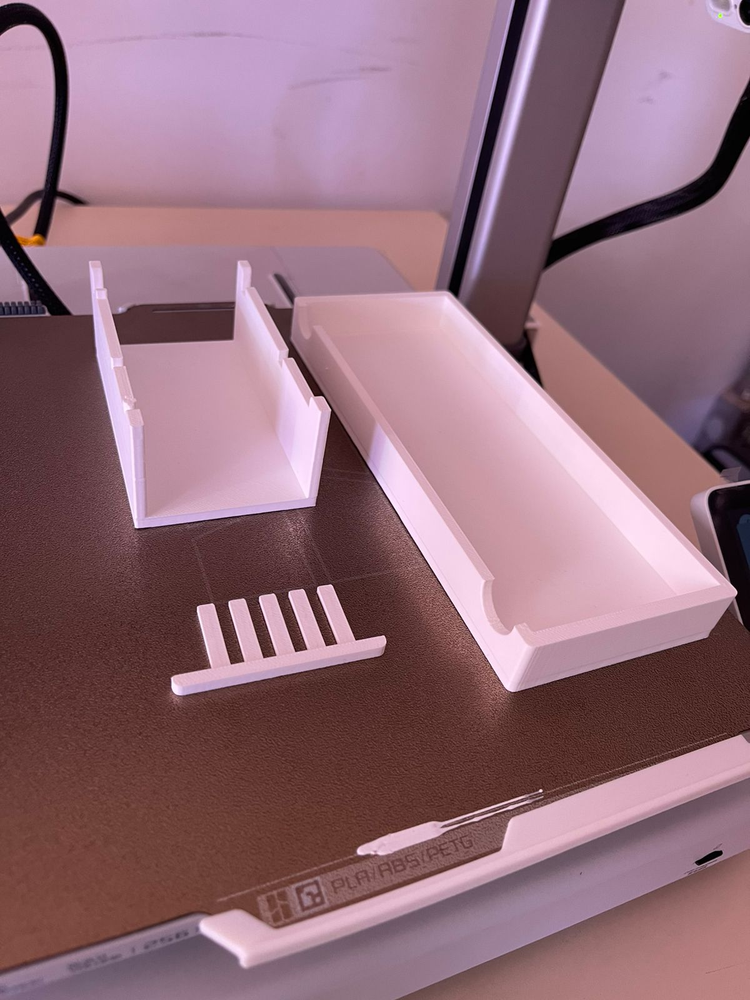
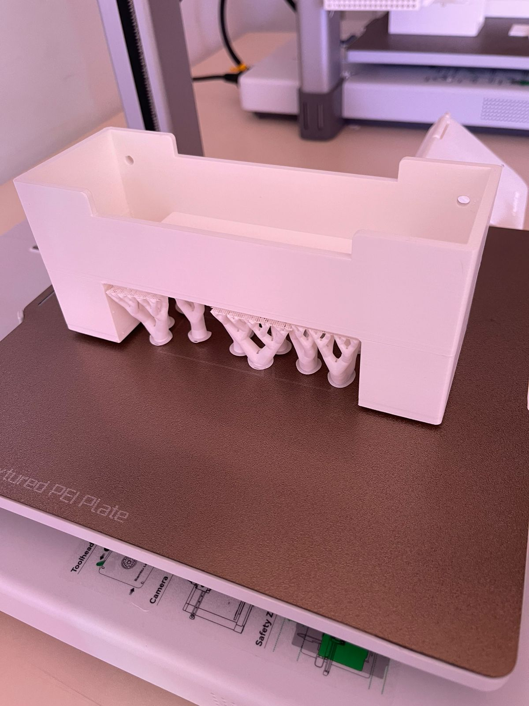
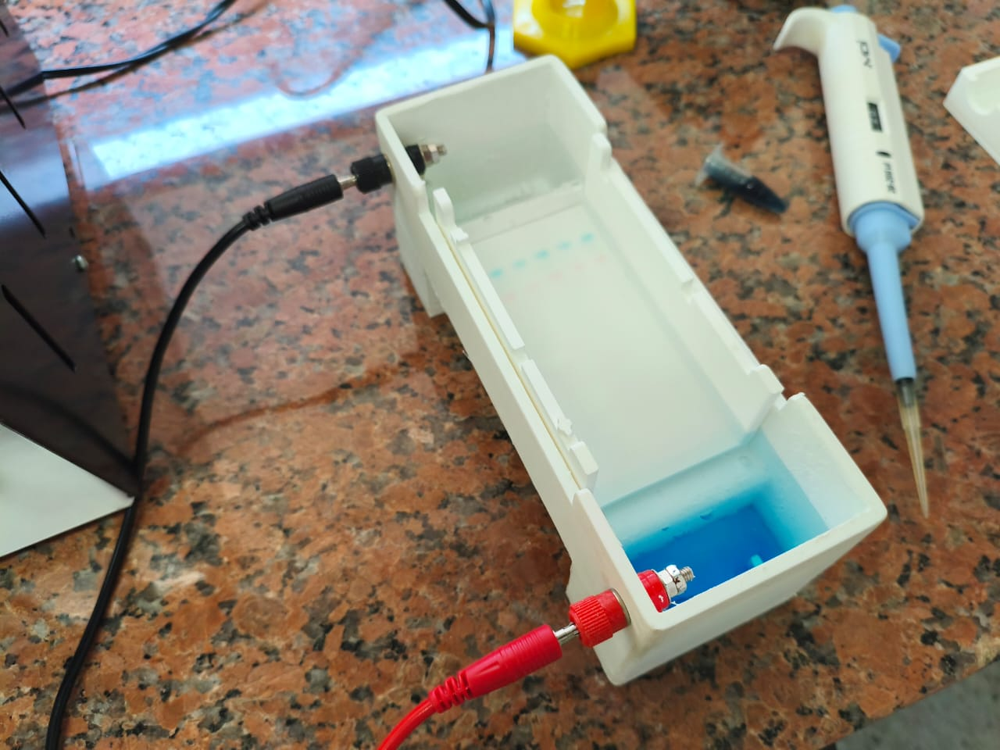
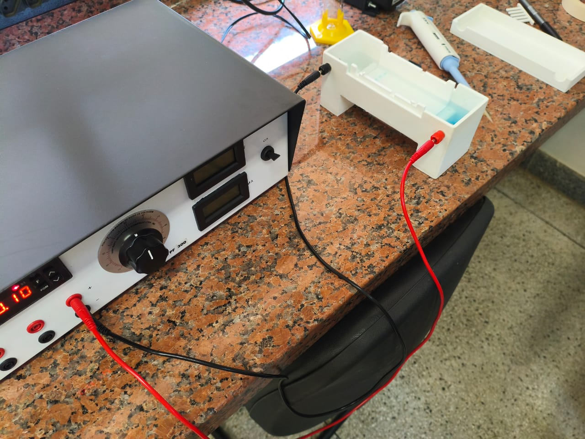
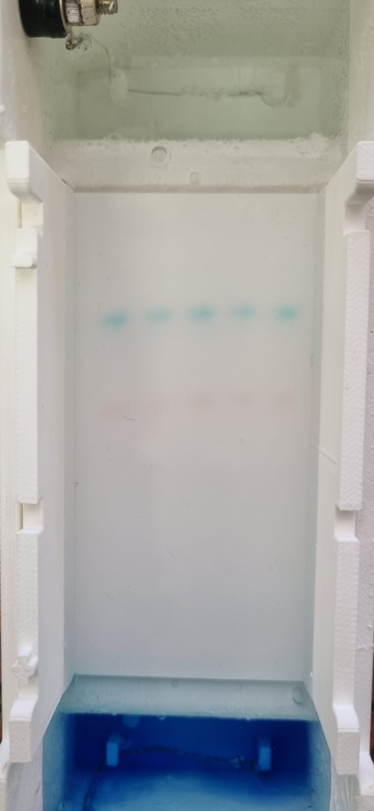
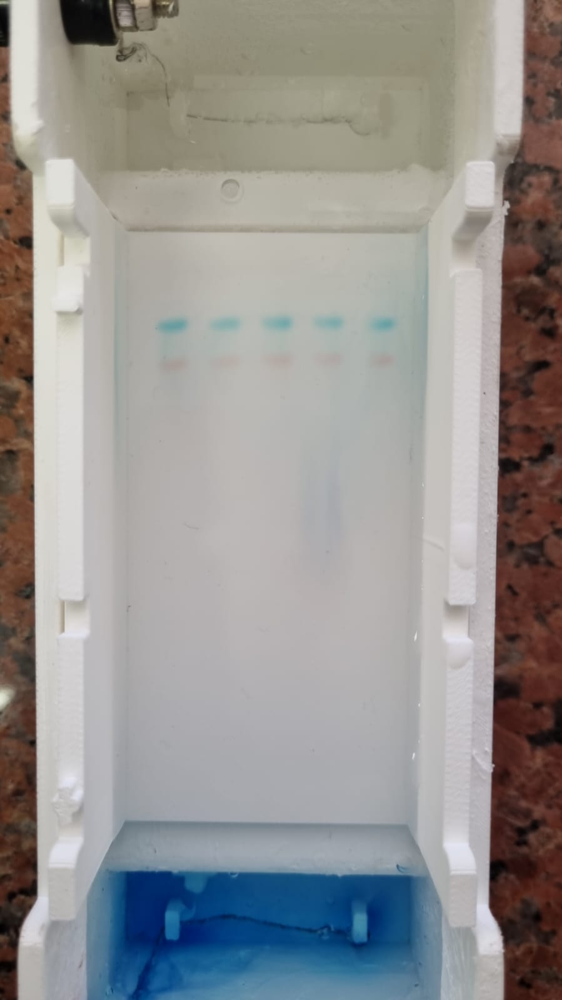

# Fotografias

Registros da atividade apresentada na [pasta do projeto, curso ou evento](../README.md).

## Arquivos

- [eletroforese1.jpeg](<eletroforese1.jpeg>)
- [eletroforese2.jpeg](<eletroforese2.jpeg>)
- [eletroforese3.jpeg](<eletroforese3.jpeg>)
- [eletroforese4.jpeg](<eletroforese4.jpeg>)
- [eletroforese5.jpeg](<eletroforese5.jpeg>)
- [eletroforese6.jpeg](<eletroforese6.jpeg>)
- [eletroforese7.jpeg](<eletroforese7.jpeg>)
- [eletroforese8.jpeg](<eletroforese8.jpeg>)
