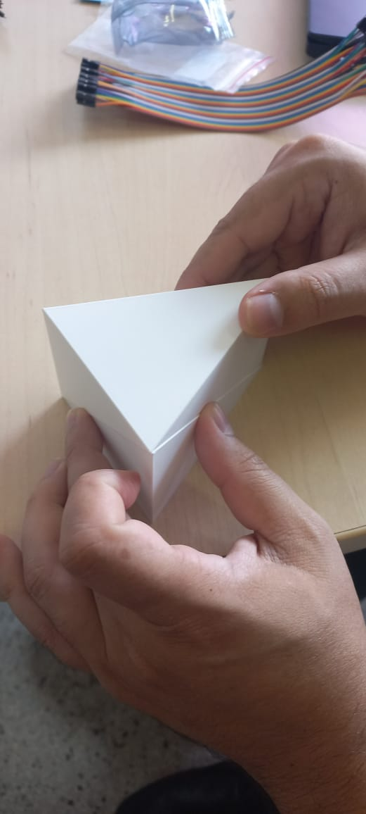
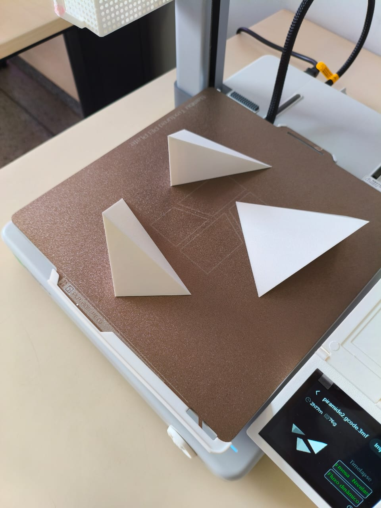

# Fotografias

Registros da atividade apresentada na [pasta do projeto, curso ou evento](../README.md).

## Arquivos

- [piramides_e_prisma1.jpeg](<piramides_e_prisma1.jpeg>)
- [piramides_e_prisma2.jpeg](<piramides_e_prisma2.jpeg>)
