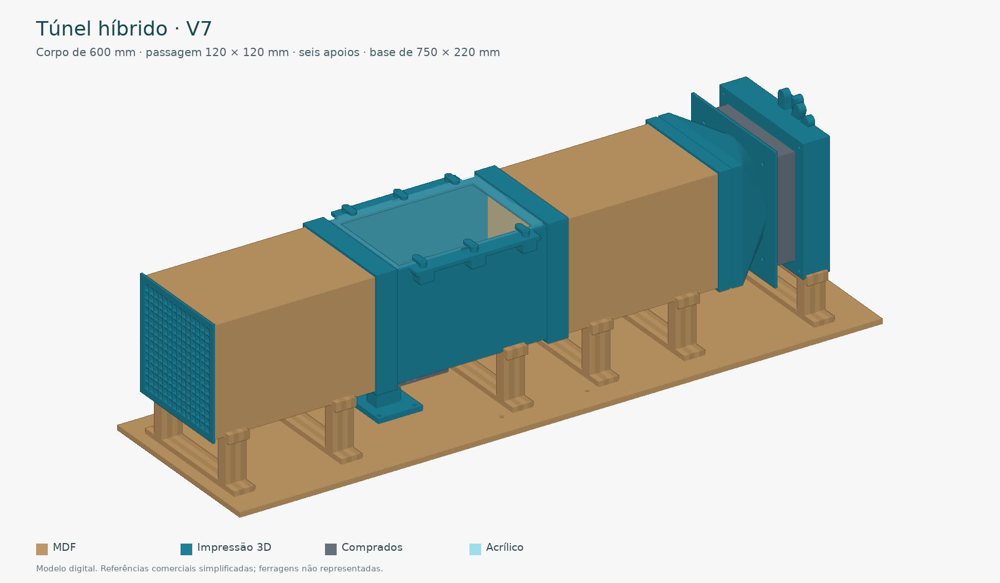
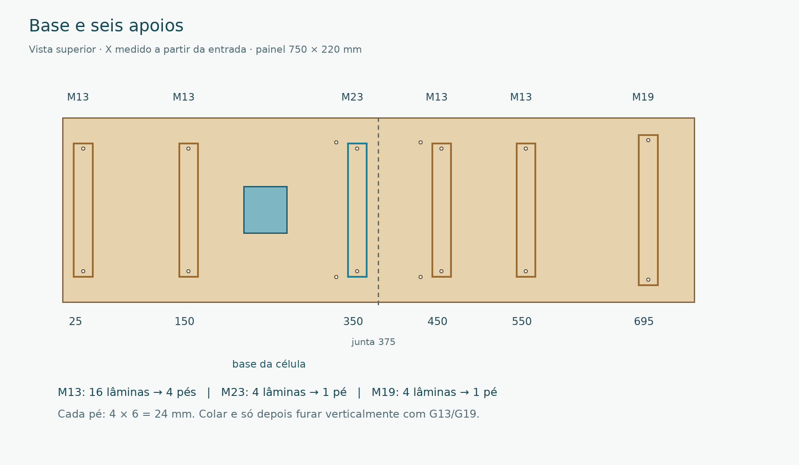
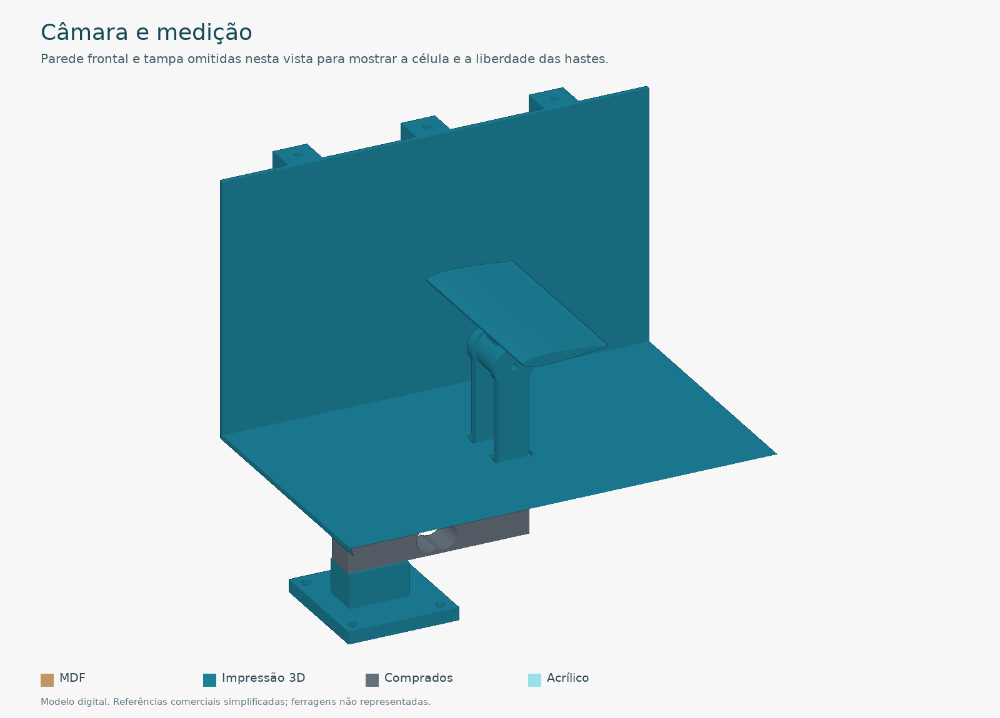

# Mini túnel de vento · V7 híbrido

MDF + impressão 3D · revisão de 06/10/2026 · unidades em milímetros

Um único pacote para fabricar e montar o túnel. O corpo tem três módulos de 200 mm: entrada em MDF, câmara impressa e saída em MDF. A passagem nominal é 120 × 120 mm. O conjunto usa seis apoios sobre um painel de 750 × 220 mm.

**Materiais definidos:** MDF de 3 mm nos dutos, MDF de 6 mm nos apoios e na base opcional, acrílico de 3 mm na tampa. Os demais componentes mecânicos são impressos ou comprados.

**Correções desta revisão:** moldura da janela com teto interno corrigido em 1,6 mm; apoio próprio para a câmara; ferragens da base revistas para M4 × 20. O pacote contém somente as peças da versão híbrida, com alternativas e testes separados.

As verificações digitais confirmam as dimensões e as interfaces revisadas. O relatório registra 90 interseções booleanas sem colisões. Não houve montagem física, ensaio de carga ou teste de fluxo. Os cupons e a montagem a seco continuam necessários.

---

## 1. Encontrar os arquivos certos

| Pasta | O que contém | Como usar |
|---|---|---|
| 01_IMPRESSAO_3D/01_pecas_finais | STL das peças padrão | Fatiar individualmente, escala 100%, com as quantidades da lista |
| 01_IMPRESSAO_3D/02_alternativas_escolher_uma | Asa B e machos alternativos da ligação | Substituir a peça padrão correspondente; não somar à montagem |
| 01_IMPRESSAO_3D/03_testes_antes_do_lote | Cupons e gabaritos impressos | Fazer antes das peças grandes |
| 02_CORTE_LASER/MDF_3mm | Dutos, gabaritos e cupons de MDF | Cortar SVG ou DXF, em 1:1 |
| 02_CORTE_LASER/MDF_6mm | Pés laminados e base opcional | Cortar SVG ou DXF, em 1:1 |
| 02_CORTE_LASER/ACRILICO_3mm | Tampa transparente | Cortar em acrílico; não é MDF |
| 03_COMPRADOS_NAO_FABRICAR | Lista de ferragens, ventoinha, célula e consumíveis | Comprar ou reaproveitar; modelos são referências |
| 05_VISUALIZACAO | Imagens, STL/OBJ completos e visualizador 3D local | Examinar a montagem; não fabricar esses conjuntos |
| 06_CAD_VALIDACAO | Fontes editáveis e relatório de verificação | Editar ou conferir o projeto |

O visualizador `05_VISUALIZACAO/ABRIR_VISUALIZADOR_3D.html` funciona localmente no navegador, sem servidor ou internet. Arraste para girar, use a roda para aproximar e marque **Abrir dutos e janela** para examinar o interior. **Explodir** separa os componentes; essa posição é ilustrativa.

Os arquivos de chapa já têm as quantidades completas. Não corte também os desenhos individuais do mesmo lote. SVG e DXF são duas alternativas do mesmo desenho: importe apenas um formato. Asas A/B e ligações 126,2/126,0/125,8 também são alternativas.

Todas as peças necessárias estão dentro desta pasta. O pacote não depende dos diretórios V5/V6 anteriores. As cinco partes recebidas estão em `01_pecas_finais` e podem ser reaproveitadas se já estiverem prontas.

---

## 2. Conferir material e encaixes antes do lote

1. Meça a espessura de cada lote de MDF. O desenho usa 3 e 6 mm nominais. A espessura dos dutos altera o exterior, as luvas e os apoios; não corrija isso mudando a escala geral dos desenhos.
2. Corte os cupons em `MDF_3mm/cupons`. T01 é o piso/teto do tubo curto; T02 é a lateral; T03 é o cupom de kerf. Guarde o quadrado interno de 10 mm e meça quadrado e abertura. Estimativa de kerf: (abertura − quadrado)/2.
3. Cole dois T01 e dois T02 como na seção dos dutos: as laterais ficam entre piso e teto. Confirme interior de 120 × 120 e exterior de 126 × 126.
4. Imprima `T08_cupom_luva_MDF`. O tubo curto deve entrar à mão. Teste U01/U02 na câmara também. As folgas totais nominais são 0,4 mm: abertura 126,4 para MDF e 125,2 para a câmara de 124,8.
5. Teste `T07_cupom_parte5_macho_126p2` dentro da parte 5. Se necessário, teste 126,0 e 125,8 e escolha a ligação com o mesmo macho. Todas as variantes deste pacote têm luva própria para MDF.
6. Use T05 na ventoinha real. Os cinco STL recebidos usam 105 mm entre centros; a medida anteriormente informada de 110 mm é diferente. Resolva na peça real antes de fabricar as partes externas.
7. Use T03/T04 **impressos** para verificar fixação da janela, e T06 para furos/rosca da célula. O cupom impresso T04 mantém a região de fixação da moldura V5: essa região não mudou na V7.

**Laser:** desenhos nominais sem compensação de kerf. Configure a compensação uma única vez se quiser conservar as medidas finais. Corte aberturas internas antes do perímetro externo. Confirme uma medida de 200 mm no software e a espessura indicada na pasta. Use o perfil de corte validado para sua máquina e material.

**Impressão:** STL individuais abaixo de 255 mm por eixo, em escala 100%. Use o perfil de PLA validado no laboratório. Tubos/colmeia e conexões devem conservar as dimensões internas; suporte e base da célula precisam de rigidez. Examine a prévia de camadas de cada peça.

---

## 3. Colar os dois dutos de MDF

| Módulo | Piso e teto | Laterais | Resultado |
|---|---|---|---|
| Entrada unificada | 2 × M01, 200 × 126 | 2 × M02, 200 × 120 | Um tubo de 200 mm |
| Saída | 2 × M03, 200 × 126 | 2 × M04, 200 × 120 | Um tubo de 200 mm |

1. Faça montagem a seco sobre superfície plana. As laterais de 120 mm ficam **entre** piso e teto, alinhadas às bordas externas de 126 mm. Não coloque as laterais por fora dos painéis largos.
2. Confira o esquadro: largura interna = 126 − 3 − 3 = 120; altura interna = 120. As duas diagonais da seção devem coincidir.
3. Cole as quatro juntas longitudinais. Use grampos leves, fita e espaçadores removíveis para manter o interior. As paredes são coladas de topo, sem dentes ou encaixe por pressão. Não cole os espaçadores ao duto.
4. Espere a cura com as extremidades alinhadas. Remova excesso de cola e limpe os resíduos da borda cortada. Não deixe ressaltos dentro da passagem.
5. Aplique selador compatível no interior e nas bordas, sem engrossar significativamente os encaixes. Espere a cura completa e reteste a luva. Faça vedação fina nas juntas se necessário.

Cada duto de quatro painéis fica permanente após a colagem. A montagem entre dutos e câmara continua desmontável pelas luvas e fita externa removível.

---

## 4. Laminar os seis apoios e preparar a base

| Apoio | Lâminas MDF 6 mm | Posição X | Altura do patamar | Berço livre |
|---|---:|---|---:|---:|
| Quatro pés M13 dos dutos | 4 por pé; 16 total | 25, 150, 450, 550 | 59,4 | 126,4 |
| Pé M23 da câmara | 4 | 350 | 60,0 | 125,2 |
| Pé M19 externo | 4 | 695 | 47,4 | 150,4 |

1. Cole quatro lâminas alinhadas para cada apoio. A espessura final na direção X é 24 mm. Identifique M13, M23 e M19: têm patamares diferentes e não são intercambiáveis.
2. Alinhe a face inferior e o patamar durante a cura. Não deixe cola acumulada no berço. A diferença de 0,6 mm entre M13 e M23 conserva o piso interno contínuo a Z=62,4.
3. Fure os apoios **após a colagem**, com broca Ø4,5 perpendicular à travessa inferior. G13 serve para M13 e M23; G19 serve para M19. Centralize o gabarito sobre a travessa inferior, com a borda longa paralela a Y. Os centros são X=0/Y=±73 nos apoios de 160 mm e X=0/Y=±83 no apoio de 180 mm. Esses furos verticais não aparecem no perfil de corte do laser.
4. Se usar a base opcional, una B01 e B02 pelas bordas de 220 mm para obter 750 × 220. A junta fica em X=375. As duas talas B03 de 200 × 40 ficam **por baixo**, de X=275 a 475, centradas em Y=±80.
5. Os quatro furos das talas ficam em X=325/425 e Y=±80. Escareie manualmente a face superior da base para as cabeças ficarem niveladas. Prenda com quatro M4 escareados × 20, porcas e arruelas; confira o comprimento real.
6. Prenda os seis apoios com doze M4 × 20, porcas e arruelas. A base da célula usa mais quatro M4 × 20. O comprimento de 16 mm da versão anterior pode ficar curto ao somar porca e arruelas à pilha de 12 mm; por isso foi revisto.
7. Apoie o painel de modo estável, com pelo menos 20 mm livres sob sua face inferior para as talas, porcas e pontas dos parafusos. Confira planicidade e flexão com o conjunto instalado. A base de 6 mm é uma opção de fabricação, sem cálculo de carga; use painel existente mais rígido se necessário.

---

## 5. Unir os módulos e alinhar a passagem

1. Posicione a entrada MDF em X=0..200, a câmara em X=200..400 e a saída MDF em X=400..600. A origem X=0 é a face de entrada do corpo, antes da aba da colmeia.
2. Encaixe **U01** na emenda X=200. A abertura 126,4 fica para a entrada MDF; a abertura 125,2 fica para a câmara. U01 ocupa X=188..212, 12 mm de cada lado.
3. Encaixe **U02** na emenda X=400. A abertura 125,2 fica para a câmara; a abertura 126,4 fica para a saída MDF. U02 ocupa X=388..412. No STL de fabricação, U01 tem lado MDF em Z=0..12 e U02 em Z=12..24: identifique os lados antes da montagem.
4. Encoste as extremidades dos módulos. Não deixe folga axial. A metade menor impede o MDF de ultrapassar o meio da luva; o lado da câmara é alinhado pelo contato com o duto.
5. Confira contato com os cinco apoios do corpo, inclusive M23 em X=350. O piso interno deve ficar contínuo em Z=62,4; o centro da passagem, em Z=122,4. Vede por fora com fita removível e retenha as luvas para não deslizarem.
6. Instale a colmeia na entrada: miolo 119,2, folga total nominal 0,8, canais inseridos em 46 mm e aba para fora. Prenda a aba externamente para não cair.
7. A ligação 08 MDF cobre X=588..600. O ombro de 3 mm ocupa X=600..603 e o macho de 12 mm vai até X=615. A parte 5 entra até o ombro. Apoie o conjunto externo no M19 antes de apertar suas fixações.

| Referência | Dimensão |
|---|---|
| Exterior MDF / câmara | 126 / 124,8 |
| Piso externo MDF / câmara | Z=59,4 / Z=60 |
| Piso interno de ambos | Z=62,4 |
| Teto interno nos trechos fechados, com moldura V7 | Z=182,4 |
| Janela aberta na moldura | 156 × 108; tampa 172 × 120 |

---

## 6. Fechar a janela com a moldura corrigida

Use **04_moldura_V7_passagem_120mm.stl**. A moldura V5 tinha 4 mm de espessura atravessando a passagem, com face inferior em Z=180,8; isso produzia altura livre de 118,4 mm nos trechos cobertos. A V7 retira 1,6 mm apenas da região sobre o canal, mantendo os apoios externos, os seis furos e os batentes da tampa.

1. Imprima a moldura individual com a orientação do STL. O rebaixo de 1,6 mm na face inferior precisa de suporte localizado; confira a prévia. Remova o suporte e deixe as superfícies internas lisas. Não use novamente a moldura V5 inteira neste pacote.
2. Assente a moldura na câmara. A superfície de apoio externa continua em Z=180,8; o teto interno fica em Z=182,4, e a face superior continua em Z=184,8. Confira alinhamento dos seis furos sem forçar.
3. Aplique vedação fina ao redor da abertura; a referência é aproximadamente 0,5 mm comprimida. Coloque o acrílico 172 × 120 × 3 sem furá-lo.
4. Coloque os seis espaçadores 12 de 3,5 mm nos parafusos, por fora do acrílico. As seis presilhas 11 ficam sobre eles e giram para liberar a tampa.
5. Use seis M3 × 25 com porcas e arruelas como ponto de partida. Confira a pilha real e o engate da porca; aumente o comprimento se a vedação/arruelas exigirem. Aperte somente até reter a chapa, sem flexioná-la.
6. Vede por fora a emenda entre câmara e moldura se houver vazamento. As hastes da medição precisam continuar livres no piso.

A tampa está separada em `02_CORTE_LASER/ACRILICO_3mm`. Se já tiver o acrílico V5, ele continua compatível. Não substitua a tampa transparente por MDF.

---

## 7. Instalar célula, suporte e asa

1. Identifique a rosca e a profundidade útil dos furos da célula real. Os rasgos dos STL medem 5,6 mm e permitem ajuste; eles não definem a rosca do sensor.
2. Fixe a extremidade da célula à base 14. Os parafusos entram por baixo: faça essa montagem **antes** de prender a base ao painel. O trecho central da célula deve ficar livre.
3. Prenda a base ao painel nos quatro furos X=220/261 e Y=±22 em relação à linha central. Confira porcas, arruelas e pontas na parte inferior do painel.
4. Na extremidade livre, coloque espaçador 15 e suporte 16. Prenda com os dois parafusos da rosca correta. A distância nominal da cabeça inferior à célula é cerca de 17 mm; a pilha superior mede 8 mm. Some as arruelas e o engate permitido, sem chegar ao fundo da rosca.
5. Passe as duas hastes pelos rasgos do piso. Centralize sem tocar em piso, laterais ou moldura. O apoio M23 começa em X=338, depois do suporte, e não deve tocar na parte móvel.
6. Coloque a asa A entre as orelhas do suporte e atravesse um M3 × 35 com arruelas/porca. Ajuste o ângulo com transferidor e trave suavemente. A asa B é alternativa: use uma asa por vez.
7. Verifique movimento livre nos cinco ângulos −20°, −15°, 0°, 15° e 20°, e confira novamente depois de fechar a janela. Deixe os fios folgados, sem tracionar a extremidade livre.

As asas têm corda de 40 mm e envergadura de 90 mm. O conjunto mede uma componente de força e não separa sustentação e arrasto simultaneamente. Faça tara, calibração com massas conhecidas e ensaio do suporte sem asa após montar a versão híbrida.

---

## 8. Montar ventoinha e regulador

**Sequência do ar:** ligação MDF → parte 5 → ventoinha → parte 1 → grade 09 → espaçador 20 → parte 2 → parte 3 invertida → alavanca parte 4.

1. Prenda a ventoinha entre parte 5 e parte 1, com quatro M4 × 55, porcas e arruelas. Os furos das peças ficam a 105 mm entre centros. Confira a ventoinha real e seu sentido de fluxo: deve puxar o ar pelo túnel e expulsar pelo regulador.
2. Coloque a parte 2 com o ressalto central e o pino voltados para fora. Na posição montada, as pequenas abas marcadas ficam para cima.
3. Vire a parte 3: os rebaixos cônicos dos dois parafusos da alavanca ficam voltados à parte 2. Passe dois M3 escareados × 12 pelo disco e prenda a alavanca parte 4 na face externa. As cabeças devem ficar niveladas com a face do disco.
4. Encaixe o furo central no ressalto da parte 2 e o rasgo curvo no pino. Na abertura máxima, a alavanca aponta para cima e as janelas dos discos ficam alinhadas.
5. Prenda o eixo com M4 × 20, porca e arruela de retenção de diâmetro externo próximo de 12 mm. A arruela deve apoiar no ressalto, sem prensar o disco. A geometria reserva folgas de 0,2 mm abaixo e 0,4 mm acima do disco.
6. Prenda parte 1, grade 09, espaçador 20 e parte 2 com quatro M3 × 40 nos furos externos de passo 136 mm. As porcas M4 da ventoinha ficam nos alívios grandes da grade. Nenhuma ponta pode tocar pás ou disco.
7. Confira apoio no M19 e retenção da ligação MDF/parte 5. Gire pás e disco manualmente com a fonte desligada antes de ligar.

Os cinco STL recebidos foram preservados. O disco reduz a abertura, mas não fecha completamente no curso geométrico de cerca de 28°. Suas marcações e o PWM não representam velocidade do ar nem porcentagem de vazão.

---

## 9. Conferência final e limites da validação

1. Confira as espessuras dos materiais e as variantes usadas. Todas as emendas devem entrar à mão e ficar retidas, sem deformar paredes.
2. Verifique os seis apoios, a união das duas metades da base e a folga inferior para porcas/talas. O painel precisa ficar estável, sem balanço ou flexão perceptível na medição.
3. Confira alinhamento dos pisos e ausência de cola, suporte de impressão ou selador criando degraus no canal. Faça inspeção pelo interior com a tampa aberta.
4. Confirme que hastes, célula e asa não tocam no corpo, apoio M23 ou janela. Confirme folga dos fios e liberdade da parte móvel.
5. Gire a ventoinha e o regulador manualmente, com a fonte desligada. Verifique pontas dos parafusos e grade.
6. Ligue com a instalação elétrica adequada aos componentes reais. Fonte, controlador, HX711, placa e programa dependem do equipamento disponível e não foram dimensionados nesta revisão mecânica.
7. Faça tara sem vento, calibração com massas conhecidas e ensaio sem asa. Observe vibração, vazamentos e repetibilidade antes de realizar comparações aerodinâmicas.

**Conferido digitalmente:** 30 STL de fabricação com malhas fechadas; sete chapas MDF com quantidades e margens; moldura com altura interna corrigida; furos do novo apoio; 90 interseções nas interfaces modificadas e mais 40 das asas A/B nos cinco ângulos contra câmara, moldura, suporte e acrílico; hashes das cinco peças recebidas.

**Ainda não ensaiado:** corte físico, impressão, acabamento, tolerâncias reais, rigidez da base, vedação, vibração, proteção real da ventoinha, calibração ou fluxo. Os modelos comerciais no visualizador são simplificados; os furos/roscas reais devem ser conferidos.

Os testes de colisão abrangem interfaces revisadas e componentes vizinhos; não incluem ferragens não modeladas nem substituem teste estrutural. Para consultar os resultados completos, abra `06_CAD_VALIDACAO/relatorio_verificacao.json` ou o resumo de verificação na pasta de documentos.

Use `02_LISTA_FABRICACAO.pdf` para quantidades e materiais. Reaproveite peças prontas compatíveis; na impressão padrão são 29 unidades em 19 arquivos distintos, incluindo uma asa. Alternativas e cupons ficam fora dessa quantidade.
